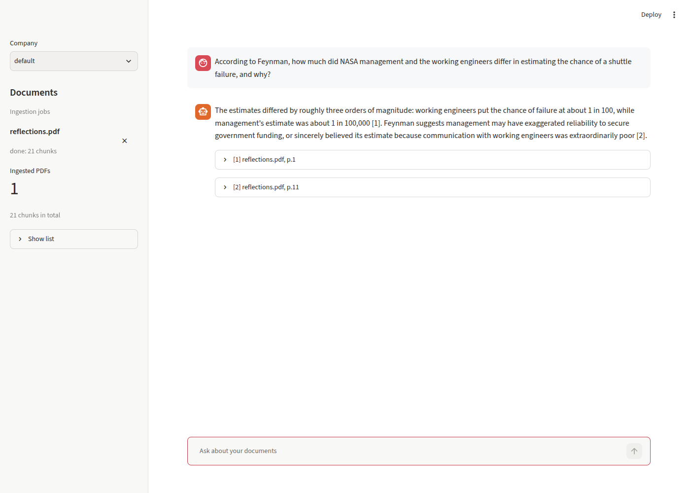
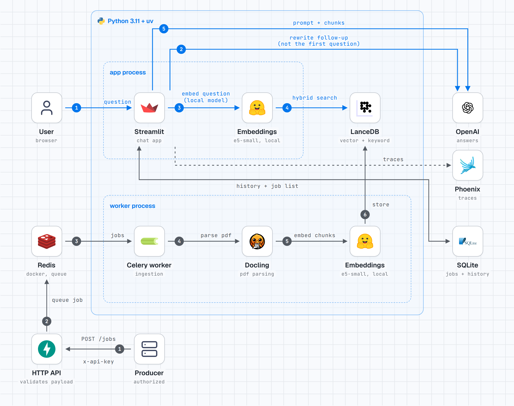

# RAG pipeline

[](https://github.com/alessmar/rag-pipeline/actions/workflows/test.yml)
[](LICENSE)
[](pyproject.toml)

Question answering over PDF documents, with answers that cite the exact paragraph and page. PDFs are parsed with Docling, embedded locally, stored in LanceDB, and answered by an OpenAI model. Traces go to Phoenix.



## Why

I wanted to build a RAG pipeline that is performant and reusable, and to learn the pieces of RAG engineering along the way: parsing, chunking, embeddings, hybrid search, citations, and the queue that feeds them.

## How

I built it with the help of Claude Code, but I directed the architecture and chose the libraries myself, such as Docling for parsing and Celery for the ingestion queue.

<picture>
  <source media="(prefers-color-scheme: dark)" srcset="diagrams/rag-stack-dark.png">
  
</picture>

## Quick start (Docker)

You need [Docker](https://docs.docker.com/get-docker/) with Compose, an [OpenAI API key](https://platform.openai.com/api-keys) and about 8 GB of free RAM.

```
git clone https://github.com/alessmar/rag-pipeline.git
cd rag-pipeline
cp .env.example .env
```

Open `.env` and paste your key after `OPENAI_API_KEY=`. Then:

```
docker compose up --build
```

The first start builds the image (about 5 GB of disk) and the first PDF downloads the models (about 1.4 GB, once). When it is running:

- the chat app is at http://localhost:8501
- Phoenix, which shows what each question retrieved and sent to OpenAI, is at http://localhost:6006

**Add a PDF.** Documents belong to a company (a tenant), and `RAG_DEFAULT_TENANT` in your `.env` is the default one: see "Configure tenants" below. Documents arrive through the queue, from a URL. In a second terminal, give the app a public `https` link to a PDF:

```
docker compose exec app sh -c 'python scripts/produce.py --tenant "$RAG_DEFAULT_TENANT" https://example.com/yourfile.pdf'
```

The job list in the app's sidebar shows each job as queued, running, done or failed, and the PDF count updates when it finishes. Each line has an X icon: on a finished job it removes the job from the list, and on a job that has not started yet it cancels it (the worker then skips it). A job in progress has no X, because a running ingestion cannot be stopped safely.

**A PDF on your disk.** The worker only downloads from the network, so serve the folder from your machine and let the worker reach it. From the project folder:

```
GATEWAY=$(docker network inspect rag-pipeline_default --format '{{(index .IPAM.Config 0).Gateway}}')
echo "RAG_FETCH_ALLOW=$GATEWAY" >> .env
docker compose up -d worker
python3 -m http.server 8000 --bind $GATEWAY --directory path/to/pdfs
```

Leave the server running, and in a second terminal queue the file:

```
docker compose exec app sh -c "python scripts/produce.py --tenant \"\$RAG_DEFAULT_TENANT\" http://$GATEWAY:8000/yourfile.pdf"
```

`$GATEWAY` is the address of your machine on the Compose network. Use it in the URL, not `127.0.0.1`: inside a container, `127.0.0.1` is the container itself. Stop the server when the job is done. `RAG_FETCH_ALLOW` is explained in "What the worker accepts" below.

It takes about a minute per 30 pages. Reload the app and ask a question about it.

The conversation is saved in `data/history.sqlite`, so it comes back after a reload or a restart, and a follow-up question can refer to the earlier ones. Each client has its own history: the app puts a random `session` id in the page URL (`?session=...`), and the history is kept for that company and that id. Keep the URL, or bookmark it, to continue later. A frontend that embeds the app can pass its own id, for example `?tenant=<uuid>&session=<user id>`, to give every user a stable history. The id is not a password: anyone who has the full URL sees that history. `RAG_HISTORY_DB` changes the file. **Clear history** in the sidebar deletes it.

**Stop and clean up.** `Ctrl+C` stops everything, and your documents are kept. `docker compose down -v` also deletes the documents, the chat history, the queue and the downloaded models.

Below you will find how to configure tenants, how search works, how much RAM it needs, and how the ingestion queue behaves.

## Configure tenants

A tenant is a company. Each one has its own documents, search and chat history, and they never mix. A tenant is a UUID with a display name, and the names are listed in `tenants.json`.

- **`RAG_DEFAULT_TENANT`** is the UUID of the company the app opens on, and the one the ingestion commands above use. It can be any UUID. `.env.example` has one you can keep, or make your own: `python3 -c "import uuid; print(uuid.uuid4())"`.
- **Docker creates `tenants.json` for you.** On the first start it writes one company, your `RAG_DEFAULT_TENANT`, named "default". The file lives in the data volume at `/app/data/tenants.json`, so it is kept across restarts and never overwritten.
- **To add a company**, put a new UUID and a name in that file:

  ```
  docker compose exec app python -c "
  import json, uuid
  f = '/app/data/tenants.json'
  d = json.load(open(f)); d[str(uuid.uuid4())] = 'acme'
  json.dump(d, open(f, 'w'), indent=2); print(json.dumps(d, indent=2))"
  ```

  It prints the file, with the new UUID. Reload the page and the company appears in the sidebar dropdown, with no restart.
- **To rename a company**, change its name in the file. This renames the default company to "acme":

  ```
  docker compose exec app python -c "
  import json, os
  f = '/app/data/tenants.json'
  d = json.load(open(f)); d[os.environ['RAG_DEFAULT_TENANT']] = 'acme'
  json.dump(d, open(f, 'w'), indent=2); print(json.dumps(d, indent=2))"
  ```

  Documents and chat history belong to the UUID, not to the name, so nothing is lost. Reload the page to see the new name.
- **To ingest into the new company**, give its UUID to `--tenant` in place of `"$RAG_DEFAULT_TENANT"`.
- **To embed the app for one company**, open `?tenant=<uuid>`. The other companies are then not listed.

## How search works

A question is answered from the 8 best chunks of the tenant's documents. They come from three rankings that are merged (reciprocal rank fusion): the closest chunks by meaning (the embedding vectors), and the best keyword matches in an Italian column and in an English column.

- **Why both kinds.** Vectors find the same meaning in different words, and even in a different language, which is how an English question finds Italian text. Keywords find exact strings such as case numbers, names and codes, which vectors are weak at.
- **Why two keyword columns.** Each chunk's language is detected when it is ingested (Italian or English, with the `lingua` library, offline), and the language most chunks of a PDF were detected in is given to all of its chunks, because a document is normally written in one language. Each chunk goes into the column of its document's language, and each column has an index that stems words for that language, so *rifiuto* finds *rifiuti* and *device* finds *devices*. A PDF where the detector is unsure about every chunk goes into both columns. A quoted phrase in a question, such as `"copia privata"`, is matched as an exact phrase.
- **Weights.** Each keyword ranking counts for half of the vector ranking, so together they weigh the same. Each ranking is 8 results deep. On ten test questions over your Italian documents, deeper rankings or full-weight keywords made the results worse. That is a small sample, so the settings are only reasonable defaults.
- **Known limit.** A PDF that really mixes both languages is searched only with the rules of its main language.
- **Follow-up questions.** When the conversation already has earlier questions, one extra OpenAI call first rewrites the new question so that it makes sense on its own ("and who are the parties?" becomes "who are the parties in case C-702/17?"), and the search uses that version. The answer call also sees the last 4 questions and answers, without their old citation numbers, which only made sense for the excerpts of that turn. The first question of a conversation makes no extra call.

Tables made before the language columns existed are upgraded by `rag reindex`. Stop the worker first, because LanceDB allows one writer, and start it again afterwards:

```
docker compose stop worker
docker compose exec app sh -c 'rag reindex --tenant "$RAG_DEFAULT_TENANT"'
docker compose start worker
```

It recomputes every chunk's language and rebuilds both indexes, and it is safe to run again. Adding a document to an old table upgrades it too, but searching one fails with a message that asks for the reindex.

## Memory requirements

Everything except the OpenAI call runs on your machine, and the models are loaded inside the Python process. That makes RAM the main resource to plan for.

Measured on a 16-core Linux machine with 32 GB of RAM, CPU only, using one 33-page PDF:

| Activity | Peak RAM (RSS) | Notes |
|---|---|---|
| Ingesting a PDF | about 4.0 GB | Docling layout models plus the embedding model. The 33-page PDF took about 40 s. |
| Answering a question | about 1.6 GB | Embedding model and LanceDB only. The LLM runs at OpenAI, not locally. |
| Streamlit app, idle after first use | about 1.9 GB | Models stay loaded between questions. |
| Phoenix server | about 0.5 GB | Grows slowly as traces accumulate. |

Recommendations:

- **8 GB of RAM** is a sensible minimum to run Streamlit, the ingestion worker and Phoenix together on one machine. Ingestion runs in the worker process (see below), so the 4 GB peak belongs to the worker and the Streamlit process stays at its idle size. The Streamlit figure above was measured before ingestion moved to the worker, so it is probably a little lower now.
- **16 GB** leaves comfortable room for larger PDFs and other applications.
- If you do not need traces, set `RAG_TRACING=0` and do not run Phoenix.

Not measured: PDFs much longer than 33 pages. Parsing memory is likely to grow with page count, so test with your largest document before sizing a server.

Disk space, measured:

- The Python environment is about 7 GB, mostly PyTorch.
- Downloaded model files are about 1.4 GB in `~/.cache/huggingface`. That folder may also contain models from other projects, so the real figure for this app can be smaller.
- The vector database is small: 152 chunks from 5 PDFs use about 1.3 MB.
- The first ingest downloads the models, so it is slower than later ones.

## Ingestion queue

A PDF is submitted as a small message and the call returns at once. A separate worker process downloads it, then does the parsing and embedding. The sidebar of the app lists each job as queued, running, retrying, done, failed or cancelled.

The queue is Celery with Redis as the broker and the result backend (`RAG_REDIS_URL` in `.env`). Docker Compose starts Redis, the app and the worker (`rag worker`) together. The worker takes one job at a time, in a single process. LanceDB allows a single writer, and ingesting a PDF peaks at about 4 GB of RAM, so do not run more than one worker.

### Submitting

`scripts/produce.py` is a throwaway producer that puts URLs on the queue:

```
docker compose exec app python scripts/produce.py --tenant <company uuid> https://files.example.com/contract.pdf
```

The message is the task `rag.ingest` with two JSON arguments, `tenant` and `url`. The PDF never travels in the message: the worker downloads it, ingests it, and keeps it in the tenant's folder (the app needs it to show the cited page). The PDF is kept only if ingestion worked. A job that fails leaves no file behind, and a failed job never overwrites the PDF of a document that was ingested earlier. Submitting a URL with the same file name again replaces that document once the new version has been ingested. Jobs queued while the worker is stopped wait in Redis and run when it starts.

Job states are kept in a small SQLite file (`data/jobs.sqlite`), because Celery's result backend cannot list jobs by tenant. A producer on another machine creates no row, so such a job appears in the sidebar once the worker starts it.

### What the worker accepts

The URL comes from a producer, so the worker treats it as hostile (this is what stops it being used to reach your internal network):

- Only `https` on the default port, with no credentials in the URL.
- The host name is resolved by the worker, and only public addresses are contacted. Private, loopback and link-local ranges (including the cloud metadata address) are refused, and so are redirects that lead there. Up to 3 redirects are followed.
- The file must start with `%PDF-` and stay below `RAG_MAX_PDF_MB` (50 by default). The download has a time limit.
- Exception: to fetch from a server on your own network (a MinIO, a NAS), list its host name in `RAG_FETCH_ALLOW`, comma separated, for example `RAG_FETCH_ALLOW=minio.internal,files.lan`. Only those exact host names skip the public-address check, and they may also use `http` and any port. A redirect to any other host is still checked as usual.

A job that can never succeed (a blocked address, a 4xx answer, not a PDF, no extractable text, a malformed message) is marked failed at once and not retried. A temporary problem (timeout, 5xx, connection error) and any other error is retried with a growing delay, up to `RAG_JOB_ATTEMPTS` attempts in total. A job that fails permanently still shows as a successful Celery task, because the worker handled it: the real outcome is in the job status.

### Running Redis safely

- Messages use JSON only, never pickle, so a message cannot run code in the worker.
- The queue is database 0 and the job results are database 1 of the same server (`RAG_REDIS_RESULTS_URL` changes that). Databases separate the data, so clearing one leaves the other, but they are not a security boundary: a password and the `noeviction` setting apply to the whole server. Redis Cluster has only database 0, so set `RAG_REDIS_RESULTS_URL` there.
- Redis is the trust boundary. Anyone who can write to it can queue a job for any tenant, because the tenant is part of the message. Keep Redis on a private network or `127.0.0.1`, set a password, and give a producer an ACL user that may only add to the queue.
- Turn on persistence (`appendonly yes`), or a Redis restart empties the queue. Set `maxmemory-policy noeviction` so Redis never drops queued jobs to free memory.
- A job that is not acknowledged within `RAG_VISIBILITY_SECONDS` (one hour by default) is handed out again, so keep it above your slowest PDF. Reprocessing is harmless, because ingesting a PDF replaces its chunks.

## Settings

All settings are environment variables, read from `.env`. Only `OPENAI_API_KEY` is required.

| Setting | Default | What it does |
|---|---|---|
| `OPENAI_API_KEY` | none | Your OpenAI key |
| `OPENAI_MODEL` | `gpt-6-luna` | Model that answers questions and rewrites follow-ups |
| `OPENAI_REASONING_EFFORT` | `low` | `none`, `low`, `medium`, `high`, `xhigh` or `max`. Reasoning tokens are billed as output |
| `RAG_DEFAULT_TENANT` | first company | UUID of the company the app opens on |
| `RAG_TENANTS_FILE` | `tenants.json` | The companies: a UUID and a display name each |
| `RAG_REDIS_URL` | `redis://localhost:6379/0` | The queue (Celery broker) |
| `RAG_REDIS_RESULTS_URL` | database 1 of the same server | Job results |
| `RAG_JOB_ATTEMPTS` | `3` | Attempts per job, the first run included |
| `RAG_VISIBILITY_SECONDS` | `3600` | A job not acknowledged in this time is handed out again |
| `RAG_MAX_PDF_MB` | `50` | Largest PDF the worker downloads |
| `RAG_FETCH_ALLOW` | empty | Host names the worker may fetch from even if private (see below) |
| `RAG_TRACING` | `1` | `0` turns Phoenix tracing off |
| `PHOENIX_ENDPOINT` | `http://localhost:6006/v1/traces` | Where traces are sent |
| `RAG_PDF_DIR` | `data/pdfs` | The PDFs, one folder per company |
| `RAG_DB_DIR` | `data/lancedb` | The vector database |
| `RAG_JOBS_DB` | `data/jobs.sqlite` | The job list |
| `RAG_HISTORY_DB` | `data/history.sqlite` | The saved conversations |
| `RAG_VECTOR_STORE` | `lancedb` | Which vector store backend to use |

## Tests

Install the dependencies with `uv sync`, then `uv run pytest` runs the suite. It needs neither Redis nor an OpenAI key, because it runs queued jobs in the calling process and replaces the OpenAI call.

## To do

1. **Keep the PDFs in external storage.** Today the PDFs are written to the container's disk (`data/pdfs`), and the app needs them to show the cited page. Store them in an object storage with an S3 interface (MinIO, Garage, Cloudflare R2, AWS S3 and so on), so the container's filesystem does not grow with every document.
2. **Support more than one cloud LLM provider.** The answer step is tied to OpenAI. Make the provider configurable (for example OpenAI, Anthropic, Google), chosen in `.env`.
